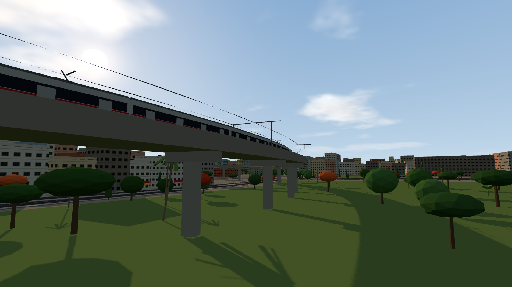
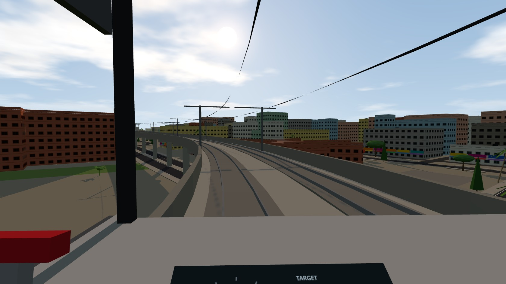
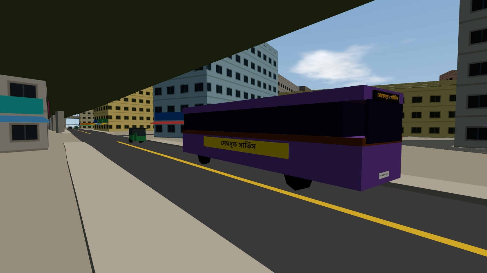
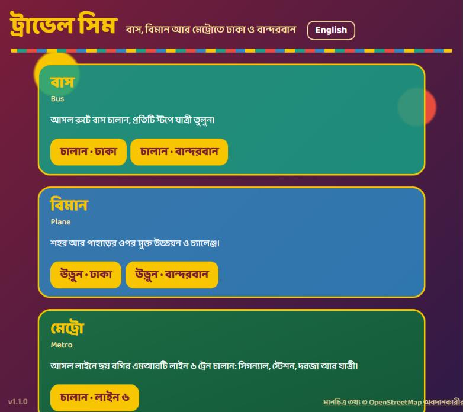
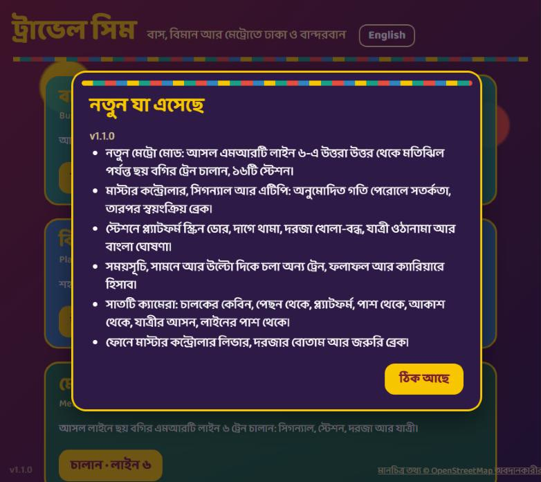

<div align="center">

# ট্রাভেল সিম · Travel Sim

**Drive a Dhaka city bus, a Dhaka Metro train, and fly over Bangladesh, in your browser.**

A relaxing bus, metro and plane simulator set on the real streets of Dhaka, its MRT Line 6 and the hill roads of Bandarban, built from OpenStreetMap and satellite elevation data. Bangla first, English optional. Free to play, works offline and on phones.

**[▶ Play now at travel-sim.pages.dev](https://travel-sim.pages.dev)**


</div>

---

## Three ways to travel

### 🚌 Bus: drive the real Route

Take a city bus up the Farmgate → Airport corridor in Dhaka, or wind up the Thanchi Road from Bandarban town to Chimbuk hill. Stop at real bus stops, open the doors, board passengers and keep to the timetable, from the driver's seat with a working dashboard and mirrors.

| | |
|:-:|:-:|
|  |  |
| *The cab is the default view: Bangla dashboard, indicators, mirrors* | *Bandarban: hairpins, bamboo and forest on the climb to Chimbuk* |

### ✈️ Plane: fly free or take a Challenge

Take off from Hazrat Shahjalal International Airport and fly over Dhaka's skyline, or cruise over Bandarban's ridges and the Sangu river. Fly freely, or take on landing and ring Challenges.

| | |
|:-:|:-:|
|  |  |
| *Lined up at Dhaka airport, the city on the horizon* | *Golden hour over the Bandarban hills* |

### 🚇 Metro: drive MRT Line 6 *(new in 1.1.0)*



Drive a six-car Dhaka Metro train along the whole of MRT Line 6, Uttara North to Motijheel: 16 stations on the real elevated alignment, with the city below. Work the master controller through power and brake notches while cab signalling and ATP watch your speed: go over the permitted speed and you get a warning, then the brakes. Stop on the mark so the train's doors line up with the platform screen doors, open them on the platform side, let people off and on, close up and wait for the dispatch signal. Keep to the timetable, with the train ahead and trains the other way sharing the line.

| | |
|:-:|:-:|
|  |  |
| *From the cab: the driver display shows speed, the permitted speed and the target* | *Platform screen doors, a waiting crowd and Bangla announcements* |

Seven cameras: the cab, chasing, on the platform, alongside, from the air, a passenger seat, and trackside.

## A living Dhaka

- **Real places.** Roads, flyovers, the Elevated Expressway, railways and level crossings come from OpenStreetMap, and the terrain from Copernicus GLO-30. Over 20 landmarks are hand-modelled, among them the Farmgate metro station, Jahangir Gate, Novo Theatre, Airport Terminal 3, Shoilo Propat and Chimbuk.
- **Dhaka traffic.** Buses, green CNGs, cars, motorbikes, painted trucks and rickshaws follow the lanes, change lanes, honk, and stop for traffic police at the big junctions. City buses carry Bangla company names, route boards and "ঢাকা মেট্রো" plates.
- **Drivable flyovers.** Ramps climb at real flyover grades; take the bus up and along the deck.
- **Trains.** Bangladesh Railway trains and Dhaka Metro sets run on the real lines; crossing booms come down as they pass.

| | |
|:-:|:-:|
|  |  |
| *Every AI bus has its company, route and number plate* | *Night: headlights, street lamps and lit windows* |

## Time of day and weather

Morning, midday, golden hour or night, in clear skies, monsoon rain or hill fog. The sky has a sun, drifting clouds and stars; buildings, flyovers and traffic cast sun shadows on the road (Medium and High quality). In the rain, drops build up on the windscreen and the wipers clear them, and traffic slows down.

## Play your way

- **Relaxed by default.** No timer pressure, no fail screens: just drive. Switch to **scored** play in Settings for fares, on-time bonuses and Fines.
- **Career.** Taka earned unlocks bus and plane Liveries. Nothing is ever spent.
- **Saves.** Progress is saved in the browser; an export code moves it to another device.
- **Bangla and English.** Switch any time with the `` ` `` key or the menu.

## Plays on phones, works offline


Touch controls work like a mobile driving sim: a steering wheel you turn with your finger (or tilt steering, or ◀ ▶ buttons), analog brake and accelerator pedals, a D/N/R gear lever and a row of icon buttons. In the plane, a floating stick (or tilt), a throttle lever and rudder buttons. On the metro, a master controller lever, door buttons and an emergency brake. Install it to your home screen; once a Region has loaded, it plays without a connection.

## Controls

**Bus**

| Action | Keyboard | Gamepad |
|---|---|---|
| Accelerate / brake (reverse when stopped) | `W` `S` or `↑` `↓` | triggers |
| Steer | `A` `D` or `←` `→` | left stick |
| Doors | `F` | |
| Horn | `H` | |
| Indicators / hazards | `Q` `E` / `X` | |
| Headlights / high beam | `L` / `K` | |
| Camera (cab ↔ chase) | `V` | |
| Map / details | `M` / `Tab` | |
| Reset to road | `R` | |
| Pause | `Esc` | |

**Plane**

| Action | Keyboard | Gamepad |
|---|---|---|
| Pitch (W = nose down) | `W` `S` | left stick |
| Roll | `A` `D` | left stick |
| Rudder | `Q` `E` | bumpers |
| Throttle up / down | `Shift` / `Z` | triggers |
| Wheel brakes | `B` | A |
| Camera / landing light / map | `V` / `L` / `M` | |

**Metro**

| Action | Keyboard |
|---|---|
| Master controller: more power / more brake (one notch) | `W` / `S` or `↑` / `↓` |
| Emergency brake | `Space` |
| Open doors left / right | `Q` / `E` |
| Close doors | `C` |
| Camera (7 views) / map | `V` / `M` |
| Pause | `Esc` |

Add `?invert=1` to the URL to invert pitch, and `?fps=1` for a frame-rate readout.

## Menus and updates

| | |
|:-:|:-:|
|  |  |
| *The main menu: Bus, Plane and Metro; tap the version in the corner for the full version history* | *After an update, a What's new card lists the changes once* |

**Current version: 1.1.0**, which adds Metro Mode on MRT Line 6.

## Build it yourself

Requires Node 20+.

```bash
npm install
npm run dev          # http://localhost:5173
```

The baked map data isn't in the repository. Build it from OpenStreetMap and GLO-30 (downloads are cached in `data/raw/`):

```bash
npm run bake -- dhaka            # bus Regions (public/regions)
npm run bake -- bandarban
npm run bake -- line6            # MRT Line 6 (the line, stations and the city along it); needs the .pbf too
npm run bake:flight -- dhaka     # Flight Zones (public/zones); needs data/raw/osm/bangladesh-latest.osm.pbf
npm run bake:flight -- bandarban
```

To release, bump the version in `package.json` and add an entry to [src/config/changelog.ts](src/config/changelog.ts); players see it once in the What's new card.

```bash
npm run build        # typecheck and production build
npm run deploy       # build and publish to Cloudflare Pages
```

**Tech:** TypeScript, [three.js](https://threejs.org) for rendering, [Rapier](https://rapier.rs) for bus physics, a kinematic flight model, Web Audio, and a Workbox service worker for offline play. Hosted on Cloudflare Pages' free plan.

The full design is in [SPEC.md](SPEC.md) and the milestone plan in [docs/build-plan.md](docs/build-plan.md).

## Credits and data

- Map data © [OpenStreetMap contributors](https://www.openstreetmap.org/copyright), ODbL. The baked Region data is offered under the ODbL.
- Terrain: produced using Copernicus WorldDEM-30 © DLR e.V. 2010-2014 and © Airbus Defence and Space GmbH 2014-2018 provided under COPERNICUS by the European Union and ESA; all rights reserved.
- Sounds from [Freesound](https://freesound.org) (CC0 and CC BY); each clip and its credit is listed in [docs/audio/sound-list.md](docs/audio/sound-list.md) and on the in-game Licences screen.
- Bus company names in the game are fictional; routes and places are real.
